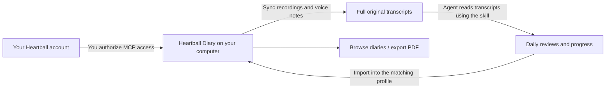

[简体中文](README.zh-CN.md) · [English](README.md) · [日本語](README.ja.md)

# Heartball Diary · 心力日记

Turn Heartball recordings and quick voice notes into days you can revisit.

Browse daily reviews, timelines, and source transcripts on your own computer. Follow progress by topic, bookmark meaningful passages, and export formatted PDF daily reports. Separate local profiles can each connect to their own Heartball account.

[Quick start](docs/QUICKSTART.md) · [Agent-specific setup prompts](docs/AGENT_GUIDE.md) · [Connect Heartball](docs/MCP.md) · [Troubleshooting](docs/TROUBLESHOOTING.md)

The application currently uses Chinese UI labels, and the detailed guides and project skills are primarily in Chinese. The instructions below keep the actual button names so you can find them; you can ask your agent to explain each step in your preferred language.

## Choose how to start

| Your situation | Start here |
| --- | --- |
| You use TRAE, Qoder, Codex, Claude Code, or Cursor and want help with setup | Copy the prompt below, or use the [agent-specific version](docs/AGENT_GUIDE.md). |
| You prefer to follow the steps yourself | [Download ZIP → install Node.js → start → authorize](docs/QUICKSTART.md). |
| You only want to see what it looks like | Download and extract the project, then open `public/index.html` to explore clearly labeled fictional examples offline. |
| You already have it installed and want to update your diary | Start the local service, open the project in your local agent, and use the update prompt below. |

## Let your local agent set it up

Use a local Codex, Claude Code, Cursor, TRAE, Qoder, or another agent session with access to your computer's files and terminal. Paste:

```text
Set up https://github.com/HBaopiqi/heartball-diary on my computer: read AGENTS.md and AGENT-SETUP.md, install the project skills for this agent, check Node and dependencies, start and verify the local website, then guide me through signing in to my own Heartball account and authorizing access; after authorization, sync and curate the first diary using heartball-sync, preserve existing data, and give me the local URL, data location, and a one-line prompt for future updates.
```

The agent can complete only the steps its permissions allow. You complete account sign-in, authorization, and system permission prompts yourself. A cloud-only or chat-only session does not automatically have access to your computer: it may help curate uploaded files, but installing the project on this computer requires local file and terminal access. See the [agent guide](docs/AGENT_GUIDE.md) for suitable entry points and tool-specific prompts.

## Start it yourself

1. Install a current [Node.js LTS](https://nodejs.org/en/download) release, version **22 or newer**.
2. [Download the repository ZIP](https://github.com/HBaopiqi/heartball-diary/archive/refs/heads/main.zip) and extract it completely. Git is not required for ZIP downloads.
3. On Windows, double-click `start.cmd`. On macOS or Linux, run `bash start.sh` from the extracted project directory.
4. Open the URL printed in the terminal, normally `http://127.0.0.1:3210`. Keep that terminal running.
5. Click “档案” at the top right, complete authorization under “连接心力球,” then click “同步原始记录.”

The first launch installs project dependencies; later launches start directly when usable dependencies are already present. The [quick-start guide](docs/QUICKSTART.md) explains each step and what to expect.

<details>
<summary>Prefer the command line?</summary>

```sh
git clone https://github.com/HBaopiqi/heartball-diary.git
cd heartball-diary
npm run setup
npm start
```

Run `npm run doctor` for environment and port checks. If Windows PowerShell blocks `npm.ps1`, use `npm.cmd run setup` and `npm.cmd start`.

</details>

Opening `public/index.html` directly is sufficient for the fictional demo. MCP connections require the local server.

## Connect your own Heartball account

The website currently has these Chinese labels:

| Button or label | Meaning |
| --- | --- |
| 档案 | Profiles, at the top right |
| 连接心力球 | Heartball connection settings |
| MCP 服务地址 | MCP service endpoint |
| 保存设置 | Save settings |
| 连接 / 授权 | Connect / authorize |
| 打开心力球授权页面 | Open the account authorization page |
| 同步原始记录 | Sync original records |
| 载入最新记录 | Load the latest records |
| 下载原文整理包 | Download a review packet |
| 导入已整理的资料 | Import a curated dataset |
| 导出日报 | Export a PDF daily report |

The server creates an empty default profile. In its connection settings, confirm the prefilled endpoint or replace it with the address provided for your account. Complete the browser sign-in and authorization yourself, then sync. See the [connection guide](docs/MCP.md) for the currently configured endpoint and its limitations. Account support and network availability depend on the service provider and your region.

The local website is the MCP client. Your agent can use its local API to obtain a review packet; configuring the same MCP separately in every agent is usually unnecessary.

## Connection, sync, and curation are different steps



- **Connection** authorizes the local service to read records from your own account.
- **Sync** retrieves and saves the original records. The first sync covers the most recent seven calendar days in Beijing time by default. Later syncs merge by source ID and recheck overlapping dates for records that may arrive late.
- **Curation** is a separate step performed by your chosen agent, using the `heartball-sync` skill to read the complete transcripts and create reviews for import. The website itself does not call a model API or require a model API key. Records that have only been synced are explicitly marked “待整理” (awaiting curation).

For later updates, open this project in your local agent and say:

```text
Use heartball-sync to sync my Heartball records, read the full transcripts for affected dates, update daily reviews and progress, import them into the correct local profile, and verify the result.
```

Codex and Cursor can use the existing `.agents/skills` directory. For Claude Code, TRAE, or Qoder, use `node scripts/install-agent-skills.mjs --agent claude`, `--agent trae`, or `--agent qoder` respectively. These commands install only the two project skills and preserve differing existing copies. See [tool-specific instructions and official references](docs/AGENT_GUIDE.md).

An agent with only file-upload support can curate an exported review packet using the included [skill](.agents/skills/heartball-sync/SKILL.md) and [dataset schema](.agents/skills/heartball-sync/references/dataset-schema.md). Import its complete JSON into the same profile afterward. Only share transcripts with an assistant you intend to use for that data. See [creating your first daily review](docs/QUICKSTART.md#生成第一份每日回顾).

## Everyday use

| What you want to do | How |
| --- | --- |
| Update records and reviews | Start the local service and use the update prompt in your project agent. |
| Revisit a day | Choose a date in “每日回顾”; use timeline entries or source buttons to check the original words. |
| Check whether the diary is up to date | Look at the query end time, actual transcript range, and curation status in “同步信息.” |
| Keep an important passage | Bookmark it in the record details; bookmarks are separated by profile. |
| Share a daily report | Choose a date, then click “导出日报” to download a PDF. |
| Back up or migrate | Use “全部记录 → 导出资料” to save JSON. For a full service backup, see [backup and upgrades](docs/QUICKSTART.md#备份与升级). |

## Your data, privacy, and backups

This is an independently maintained community project, not an official OPPO product. The repository contains only the program, documentation, and clearly labeled fictional examples. Real records live in `data/` by default, or in the directory selected by `HEARTBALL_DATA_DIR`; this runtime data is excluded from Git.

The server binds to loopback only. Profiles organize content and account connections; they are not a multi-user access-control system. Use the application on your own computer.

MCP sync connects to the service you configure. When you use an agent for curation, the selected transcripts enter that assistant's environment. Costs and availability depend on the tool or account you choose. The website does not ask for a model API key.

Stop the server before backing up its entire data directory. That backup includes local credentials and must remain private. Export a complete JSON dataset from each profile to migrate reviews and bookmarks; bookmarks are otherwise stored in the browser. See the [backup guide](docs/QUICKSTART.md#备份与升级).

The query end time and the actual returned recording range are shown separately. Missing records for a period do not prove there was no activity. PDF reports use high-resolution rendered pages to preserve Chinese text for reading and printing; their body text is not selectable.

Use `Ctrl+C` in the startup terminal to stop the service, and use the same startup script when you need it again. Back up before upgrading. For a Git checkout, use `git pull --ff-only`, then `npm ci`, and restart; preserve any local code changes.

## Development and support

```sh
npm test
```

Frontend files are in `public/`, the local server in `server/`, and setup and curation skills in `.agents/skills/`. `npm run demo` only rebuilds the public fictional examples.

Read the [troubleshooting guide](docs/TROUBLESHOOTING.md), or [open an issue](https://github.com/HBaopiqi/heartball-diary/issues) with your OS, Node version, error, and reproduction steps. Remove private transcripts, account information, and credentials from logs before sharing them.

Code is licensed under the [MIT License](LICENSE). Third-party dependencies retain their own licenses. OPPO, Heartball, and other product names belong to their respective owners.
