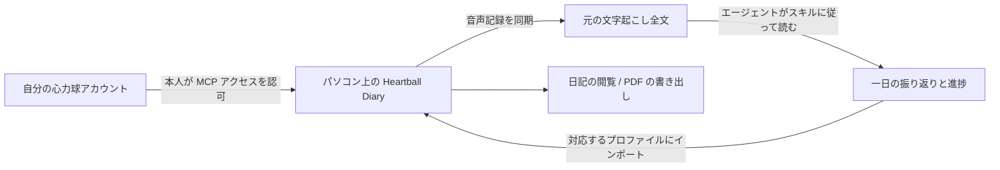

[简体中文](README.zh-CN.md) · [English](README.md) · [日本語](README.ja.md)

# Heartball Diary · 心力日记

心力球の「全时记」と「随口记」に残した音声を、あとから振り返れる日々の記録に。

自分のパソコンで、一日の振り返り、タイムライン、元の文字起こしを閲覧できます。テーマ別に進捗を追い、大切な箇所をブックマークし、レイアウトを整えた日報を PDF として書き出せます。複数のローカルプロファイルに対応し、それぞれを別の心力球アカウントに接続できます。

[はじめての方向けガイド](docs/QUICKSTART.md) · [エージェント別のセットアップ指示](docs/AGENT_GUIDE.md) · [心力球への接続](docs/MCP.md) · [よくある問題](docs/TROUBLESHOOTING.md)

アプリの UI は現在中国語です。詳しいガイドとプロジェクト用スキルも主に中国語で書かれています。画面で見つけやすいように、以下では実際のボタン名をそのまま記載しています。必要に応じて、エージェントに希望する言語で手順を説明してもらってください。

## 自分に合った始め方を選ぶ

| やりたいこと | 始め方 |
| --- | --- |
| TRAE、Qoder、Codex、Claude Code、Cursor などに設定を任せたい | 下の指示文をコピーするか、[使用するエージェント向けの指示](docs/AGENT_GUIDE.md)を使ってください。 |
| 自分で手順を確認しながら始めたい | [ZIP をダウンロード → Node.js をインストール → 起動 → 認可](docs/QUICKSTART.md)の順に進めてください。 |
| まず画面を見てみたい | プロジェクトをダウンロードして完全に展開し、`public/index.html` を開くと、架空であることを明示したサンプルをオフラインで閲覧できます。 |
| インストール済みで、日記を更新したい | ローカルサービスを起動し、このプロジェクトをローカルエージェントで開いて、下の更新用指示を使ってください。 |

## ローカルエージェントにセットアップを依頼する

パソコン上のファイルとターミナルを操作できる Codex、Claude Code、Cursor、TRAE、Qoder などのローカルエージェントに、次の指示を渡してください。

```text
https://github.com/HBaopiqi/heartball-diary をこのパソコンにセットアップしてください。まず AGENTS.md と AGENT-SETUP.md を読み、使用中のエージェントに合わせてプロジェクト用スキルを設定し、Node.js と依存関係を確認して、ローカルサイトを起動・検証してください。その後、私自身が心力球アカウントにログインしてアクセスを認可できるよう案内してください。認可後は heartball-sync を使って初回の同期と日記の整理を行い、既存データを保全したうえで、アクセス先 URL、データの保存場所、次回から一言で更新を依頼する方法を教えてください。
```

エージェントが実行できるのは、与えられた権限の範囲内の操作です。アカウントへのログイン、アクセスの認可、OS の確認画面への対応は本人が行います。クラウド上やチャット専用のセッションが、パソコンに自動的にアクセスできるわけではありません。アップロードした資料の整理には使えますが、このパソコンに直接インストールするには、ローカルファイルとターミナルを操作する機能が必要です。[エージェント別ガイド](docs/AGENT_GUIDE.md)で、適切な入口と専用の指示を確認してください。

## 自分で起動する

1. [Node.js の現行 LTS](https://nodejs.org/en/download) をインストールします。**バージョン 22 以上**が必要です。
2. [プロジェクトの ZIP](https://github.com/HBaopiqi/heartball-diary/archive/refs/heads/main.zip) をダウンロードし、すべて展開します。ZIP を使う場合、Git は不要です。
3. Windows では `start.cmd` をダブルクリックします。macOS / Linux では、展開したフォルダーのターミナルで `bash start.sh` を実行します。
4. ターミナルに表示された URL を開きます。通常は `http://127.0.0.1:3210` です。起動したターミナルは閉じずに残してください。
5. 右上の「档案」を開き、「连接心力球」で認可を完了してから、「同步原始记录」をクリックします。

初回起動時にプロジェクトの依存関係がインストールされます。次回以降、利用可能な依存関係がそろっていれば、そのまま起動します。各手順で何が表示されるかは[はじめての方向けガイド](docs/QUICKSTART.md)を参照してください。

<details>
<summary>コマンドラインを使う場合</summary>

```sh
git clone https://github.com/HBaopiqi/heartball-diary.git
cd heartball-diary
npm run setup
npm start
```

環境とポートの確認には `npm run doctor` を使います。Windows PowerShell で `npm.ps1` の実行がブロックされる場合は、`npm.cmd run setup` と `npm.cmd start` を使ってください。

</details>

架空のデモを見るだけなら `public/index.html` を直接開けます。MCP に接続するには、ローカルサーバーの起動が必要です。

## 自分の心力球アカウントに接続する

現在の画面では、以下の中国語ラベルが使われています。

| 画面上のボタン・ラベル | 意味 |
| --- | --- |
| 档案 | 右上にあるプロファイルの入口 |
| 连接心力球 | 心力球への接続設定 |
| MCP 服务地址 | MCP サービスのエンドポイント |
| 保存设置 | 設定を保存 |
| 连接 / 授权 | 接続・アクセスの認可 |
| 打开心力球授权页面 | アカウントの認可ページを開く |
| 同步原始记录 | 元の記録を同期 |
| 载入最新记录 | 最新の記録を読み込む |
| 下载原文整理包 | 整理用の原文パケットをダウンロード |
| 导入已整理的资料 | 整理済みのデータセットをインポート |
| 导出日报 | 日報を PDF として書き出す |

サーバーは空のデフォルトプロファイルを作成します。接続設定で入力済みのエンドポイントを確認するか、自分のアカウント向けに案内されたアドレスへ変更してください。ブラウザーでのログインと認可は本人が行い、その後に同期します。現在設定されている接続先と制限は[接続ガイド](docs/MCP.md)を参照してください。利用できるアカウントやネットワークの可用性は、サービス提供元と地域によって異なります。

MCP クライアントになるのはローカルサイトです。エージェントはサイトのローカル API から整理用パケットを取得できるため、通常は同じ MCP を各エージェントに個別設定する必要はありません。

## 接続・同期・整理の違い



- **接続**：ローカルサービスが、自分のアカウントの記録を読み取れるように認可します。
- **同期**：元の記録を取得して保存します。初回はデフォルトで、北京時間の直近 7 暦日が対象です。以後はソース ID ごとに差分を統合し、重複する日付も再確認して、遅れて届く記録を取り込みます。
- **整理**：選んだエージェントが `heartball-sync` スキルに従って文字起こしの全文を読み、振り返りを作成してサイトにインポートする、同期とは別の工程です。サイト自体はモデル API を呼び出さず、モデルの API キーも要求しません。原文を同期しただけの記録は「待整理」（整理待ち）と明示されます。

日常の更新では、このプロジェクトをローカルエージェントで開き、次のように依頼できます。

```text
heartball-sync を使って私の心力球の記録を同期し、更新対象日の文字起こし全文を読んで、一日の振り返りとテーマ別の進捗を更新してください。正しいローカルプロファイルにインポートし、結果を検証してください。
```

Codex と Cursor では既存の `.agents/skills` ディレクトリを利用できます。Claude Code、TRAE、Qoder では、それぞれ `node scripts/install-agent-skills.mjs --agent claude`、`--agent trae`、`--agent qoder` を使ってください。これらのコマンドはプロジェクト用の 2 つのスキルだけをインストールし、内容が異なる既存のコピーを保持します。[ツール別の手順と公式リファレンス](docs/AGENT_GUIDE.md)も参照してください。

ファイルのアップロードだけに対応したアシスタントでも、書き出した原文整理パケットを、付属の[スキル](.agents/skills/heartball-sync/SKILL.md)と[データ形式](.agents/skills/heartball-sync/references/dataset-schema.md)に従って整理できます。返された完全な JSON を、あとから同じプロファイルにインポートしてください。原文を渡すのは、そのデータの処理に使うことを自分が了承したアシスタントに限ってください。[最初の振り返りを作る手順](docs/QUICKSTART.md#生成第一份每日回顾)も参照できます。

## 日々の使い方

| やりたいこと | 操作 |
| --- | --- |
| 記録と振り返りを更新する | ローカルサービスを起動し、プロジェクトのエージェントに上の更新用指示を渡します。 |
| ある一日を振り返る | 「每日回顾」で日付を選び、タイムラインや出典ボタンから元の発言を確認します。 |
| 更新状況を確かめる | 「同步信息」で問い合わせの終了時点、実際に返された原文の期間、整理の状態を確認します。 |
| 大切な箇所を残す | 記録の詳細画面でブックマークします。ブックマークはプロファイルごとに分かれています。 |
| 一日分のレポートを共有する | 日付を選び、「导出日报」から PDF をダウンロードします。 |
| バックアップ・移行する | 「全部记录 → 导出资料」から JSON を保存します。サービス全体のバックアップは[バックアップと更新](docs/QUICKSTART.md#备份与升级)を参照してください。 |

## データ、プライバシー、バックアップ

個人がメンテナンスするコミュニティプロジェクトであり、OPPO の公式製品ではありません。リポジトリに含まれるのは、プログラム、説明文書、架空であることを明示したサンプルだけです。実際の記録はデフォルトで `data/`、または `HEARTBALL_DATA_DIR` で指定した実行時データディレクトリに保存され、Git の管理対象から除外されます。

サーバーはループバックアドレスでのみ待ち受けます。プロファイルは記録やアカウント接続を整理するための機能であり、複数ユーザー向けのアクセス制御ではありません。自分のパソコン上で使ってください。

MCP による同期では、設定したサービスに接続します。エージェントに整理を依頼すると、選んだ原文がそのアシスタントの環境に渡されます。費用と可用性は、使用するツールやアカウントによって異なります。サイトでモデル API キーを入力する必要はありません。

データディレクトリ全体をバックアップする前に、サーバーを停止してください。このバックアップにはローカルの認証情報も含まれるため、非公開で保管する必要があります。振り返りやブックマークを移行する場合は、各プロファイルから完全な JSON データセットを書き出してください。通常、ブックマークはブラウザーに保存されています。[バックアップガイド](docs/QUICKSTART.md#备份与升级)も参照してください。

問い合わせの終了時点と、実際に返された記録の期間は別々に表示されます。ある期間の記録が返されていなくても、その間に活動がなかったとは限りません。PDF は中国語の表示を保つために高解像度の描画ページとして保存され、閲覧や印刷に適していますが、本文の文字は選択できません。

サービスを停止するには、起動したターミナルで `Ctrl+C` を押します。再び使うときは、同じ起動スクリプトを実行してください。更新前にはバックアップを取ってください。Git で取得した場合は `git pull --ff-only`、`npm ci` の順に実行して再起動します。ローカルで変更したコードは保全してください。

## 開発・サポート

```sh
npm test
```

フロントエンドは `public/`、ローカルサーバーは `server/`、設定・整理用スキルは `.agents/skills/` にあります。`npm run demo` は公開用の架空サンプルだけを再生成します。

まず[よくある問題](docs/TROUBLESHOOTING.md)を確認してください。解決しない場合は、OS、Node.js のバージョン、エラー、再現手順を添えて [Issue を作成](https://github.com/HBaopiqi/heartball-diary/issues)できます。ログを共有する前に、私的な原文、アカウント情報、認証情報を取り除いてください。

コードは [MIT License](LICENSE) で公開されています。サードパーティー依存関係には、それぞれのライセンスが適用されます。OPPO、心力球などの製品名は、それぞれの権利者に帰属します。
