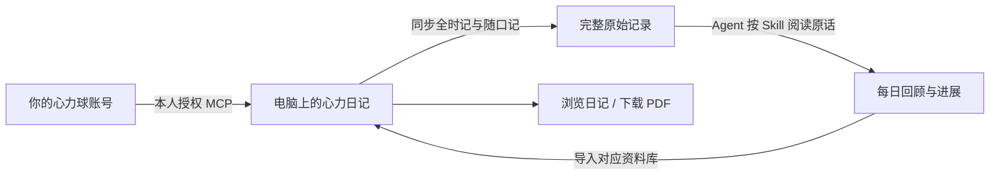

# 心力日记 · Heartball Diary

把心力球里的全时记和随口记，整理成可以回看的每一天。

在自己的电脑上浏览每日回顾、时间轴和原话，按主题追踪进展，收藏值得留下的片段，导出排版完整的 PDF 日报。支持多个本地资料库，每份资料库分别连接自己的心力球账号。

[English](README.en.md) · [小白上手](docs/QUICKSTART.md) · [各 Agent 一句话配置](docs/AGENT_GUIDE.md) · [连接心力球](docs/MCP.md) · [常见问题](docs/TROUBLESHOOTING.md)

## 选一条适合你的开始方式

| 你的情况 | 从这里开始 |
| --- | --- |
| 我有 TRAE、Qoder、Codex、Claude Code 或 Cursor，想让它帮我配置 | 复制下面的“一句话”，或使用[对应 Agent 的专用版本](docs/AGENT_GUIDE.md) |
| 我不熟悉代码，想自己跟着做 | [下载 ZIP → 安装 Node.js → 启动 → 授权](docs/QUICKSTART.md) |
| 我只想先看看长什么样 | 下载并解压项目，打开 `public/index.html`，查看明确标记的虚构示例 |
| 我已经装好，只想更新日记 | 在打开这个本地项目的 Agent 中说“更新心力球，整理新增内容并更新我的日记” |

## 复制这一句话，让 Agent 帮你配置

把下面整段发给**能够操作本机文件和终端的本地 Agent**：

```text
请在我的电脑上安装并启动 https://github.com/HBaopiqi/heartball-diary，先读仓库 AGENTS.md 和 AGENT-SETUP.md，按实际使用的 Agent 配好项目技能，完成环境检查、依赖安装和本地页面验证，再引导我本人完成心力球账号授权及首次同步整理，最后告诉我访问地址、数据位置和以后一句话更新的方法。
```

Agent 会完成它有权限执行的步骤。安装软件时的系统确认、心力球账号登录和授权仍由你本人完成。普通聊天网页可以帮你整理文件；要直接安装到这台电脑，需要本地文件与终端能力。[选择正确入口、各工具专用指令和英文指令 →](docs/AGENT_GUIDE.md)

## 自己启动，也只需要这几步

1. 安装 [Node.js 当前 LTS 版本](https://nodejs.org/en/download)，本项目要求 **22 或更新版本**。
2. [下载项目 ZIP](https://github.com/HBaopiqi/heartball-diary/archive/refs/heads/main.zip)，完整解压。
3. **Windows：双击 `start.cmd`。Mac / Linux：在解压目录的终端运行 `bash start.sh`。**
4. 打开终端显示的地址，默认是 `http://127.0.0.1:3210`，保留启动窗口。
5. 点击右上角“档案”，在“连接心力球”中完成授权，再点击“同步原始记录”。

首次启动会安装项目依赖；以后已有可用依赖时直接启动。没有 Git 也可以使用 ZIP。逐步说明和每一步应该看到的结果见[小白上手](docs/QUICKSTART.md)。

<details>
<summary>习惯命令行？展开查看</summary>

```sh
git clone https://github.com/HBaopiqi/heartball-diary.git
cd heartball-diary
npm run setup
npm start
```

环境排查：`npm run doctor`。Windows PowerShell 若提示 `npm.ps1` 无法运行，可使用 `npm.cmd run setup` 和 `npm.cmd start`。

</details>

## 连接、同步、整理，各自在做什么？



- **连接**：允许本地服务读取你自己账号的记录。[MCP 接入步骤 →](docs/MCP.md)
- **同步**：取回原文并保存。首次默认查询最近 7 个自然日，之后增量合并并回查可能晚到的记录。
- **整理**：由你使用的 Agent 按完整原话生成回顾，再导入网站。网站自身不调用模型 API；只有同步原文时，会明确显示“待整理”。

通常只需要让**本地网站连接一次 MCP**。Agent 通过本地服务取得整理包，不必先给每个 Agent 另装一套心力球 MCP 配置。

## 日常怎么用

| 想做的事 | 操作 |
| --- | --- |
| 更新记录和回顾 | 启动本地服务，在项目 Agent 中说“更新心力球，整理新增内容并更新日记” |
| 回看一天 | “每日回顾”选日期；点击时间轴或来源按钮核对原话 |
| 确认有没有更新到 | 查看“同步信息”中的查询截至、实际原文范围和整理状态 |
| 留下重要片段 | 在记录详情中收藏；收藏按资料库保存 |
| 分享一天的报告 | 选择日期 → “导出日报”，下载 PDF |
| 备份或迁移 | “全部记录 → 导出资料”，保存 JSON；完整服务备份另见[上手指南](docs/QUICKSTART.md#备份与升级) |

没有本地 Agent 时，也可以下载“原文整理包”，将它与[整理 Skill](.agents/skills/heartball-sync/SKILL.md)和[资料格式](.agents/skills/heartball-sync/references/dataset-schema.md)一起交给能读取文件的助手，再导入返回的完整 JSON。[操作说明 →](docs/QUICKSTART.md#生成第一份每日回顾)

## 数据和使用范围

这是个人维护的社区项目，与 OPPO 没有官方隶属关系。仓库只包含程序、说明和虚构示例；真实记录默认保存在电脑上的 `data/`，已被 Git 忽略。不同资料库是内容分类功能，请在自己的电脑使用。

MCP 同步会连接你配置的服务。使用 Agent 整理时，选中的原文会进入你使用的助手环境，费用和可用性取决于该工具或账号。网站不要求填写模型 API Key。

“查询截至”和“实际返回原文时段”分别显示；某段时间暂未返回，不代表没有活动。PDF 当前以高清页面保存中文，适合阅读和打印，正文不能直接选中文字。

## 开发与反馈

```sh
npm test
```

前端在 `public/`，本地服务在 `server/`，配置与整理技能在 `.agents/skills/`。`npm run demo` 只重建公开虚构示例。

遇到问题先看[常见问题](docs/TROUBLESHOOTING.md)；仍不能解决，可以[提交 Issue](https://github.com/HBaopiqi/heartball-diary/issues)，附系统、Node 版本、报错和复现步骤。请先移除日志中的私人原文、账号信息和凭据。

代码采用 [MIT License](LICENSE)。第三方依赖遵循各自许可证，OPPO、心力球等名称归各自权利人所有。
