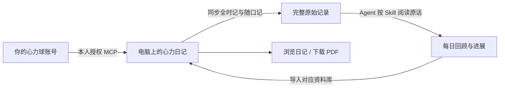

[简体中文](README.zh-CN.md) · [English](README.md) · [日本語](README.ja.md)

# 心力日记 · Heartball Diary

把心力球里的全时记和随口记，整理成可以回看的每一天。

在自己的电脑上浏览每日回顾、时间轴和原话，按主题追踪进展，收藏值得留下的片段，导出排版完整的 PDF 日报。支持多个本地资料库，每份资料库分别连接自己的心力球账号。

[小白上手](docs/QUICKSTART.md) · [各 Agent 一句话配置](docs/AGENT_GUIDE.md) · [连接心力球](docs/MCP.md) · [常见问题](docs/TROUBLESHOOTING.md)

产品界面目前为中文，详细文档与项目技能也主要使用中文。使用其他语言时，可以让 Agent 按你的偏好解释操作步骤；下文保留真实界面标签，方便对照查找。

## 选一条适合你的开始方式

| 你的情况 | 从这里开始 |
| --- | --- |
| 我有 TRAE、Qoder、Codex、Claude Code 或 Cursor，想让它帮我配置 | 复制下面的“一句话”，或使用[对应 Agent 的专用版本](docs/AGENT_GUIDE.md)。 |
| 我不熟悉代码，想自己跟着做 | [下载 ZIP → 安装 Node.js → 启动 → 授权](docs/QUICKSTART.md)。 |
| 我只想先看看长什么样 | 下载并完整解压项目，打开 `public/index.html`，离线查看明确标记的虚构示例。 |
| 我已经装好，只想更新日记 | 启动本地服务，在打开这个项目的本地 Agent 中使用下方的更新指令。 |

## 复制这一句话，让 Agent 帮你配置

把下面整段发给**能够操作本机文件和终端的本地 Agent**：

```text
请在我的电脑上安装并启动 https://github.com/HBaopiqi/heartball-diary，先读仓库 AGENTS.md 和 AGENT-SETUP.md，按实际使用的 Agent 配好项目技能，完成环境检查、依赖安装和本地页面验证，再引导我本人完成心力球账号授权及首次同步整理，保留已有数据，最后告诉我访问地址、数据位置和以后一句话更新的方法。
```

Agent 会完成它有权限执行的步骤。安装软件时的系统确认、心力球账号登录和授权仍由你本人完成。云端或普通聊天网页不会自动获得你电脑的访问权限：它可以帮你整理上传的文件；要直接安装到这台电脑，需要本地文件与终端能力。参见[正确入口、各工具专用指令和英文指令](docs/AGENT_GUIDE.md)。

## 自己启动，也只需要这几步

1. 安装 [Node.js 当前 LTS 版本](https://nodejs.org/en/download)，本项目要求 **22 或更新版本**。
2. [下载项目 ZIP](https://github.com/HBaopiqi/heartball-diary/archive/refs/heads/main.zip)，完整解压；使用 ZIP 不需要安装 Git。
3. **Windows：双击 `start.cmd`。macOS / Linux：在解压目录的终端运行 `bash start.sh`。**
4. 打开终端显示的地址，默认是 `http://127.0.0.1:3210`，保留启动窗口。
5. 点击右上角“档案”，在“连接心力球”中完成授权，再点击“同步原始记录”。

首次启动会安装项目依赖；以后已有可用依赖时直接启动。逐步说明和每一步应该看到的结果见[小白上手](docs/QUICKSTART.md)。

<details>
<summary>习惯命令行？展开查看</summary>

```sh
git clone https://github.com/HBaopiqi/heartball-diary.git
cd heartball-diary
npm run setup
npm start
```

环境与端口排查：`npm run doctor`。Windows PowerShell 若提示 `npm.ps1` 无法运行，可使用 `npm.cmd run setup` 和 `npm.cmd start`。

</details>

直接打开 `public/index.html` 可以浏览虚构示例；连接 MCP 需要启动本地服务。

## 连接自己的心力球账号

本地服务会建立一个空白默认资料库。打开其“连接心力球”设置，确认预填的 MCP 服务地址，或替换为你的账号对应的地址。账号登录和浏览器授权由本人完成，然后再同步。当前接入地址及限制见[连接说明](docs/MCP.md)；账号支持情况与网络可用性取决于服务提供方和所在地区。

| 界面标签 | 用途 |
| --- | --- |
| 档案 | 右上角的资料库入口 |
| 连接心力球 | 心力球连接设置 |
| MCP 服务地址 | MCP 服务端点 |
| 保存设置 | 保存连接设置 |
| 连接 / 授权 | 发起连接与授权 |
| 打开心力球授权页面 | 打开账号授权页面 |
| 同步原始记录 | 取回原文 |
| 载入最新记录 | 载入最新记录 |
| 下载原文整理包 | 下载供 Agent 整理的原文资料 |
| 导入已整理的资料 | 导入整理完成的数据 |
| 导出日报 | 导出 PDF 日报 |

通常只需要让**本地网站连接一次 MCP**。网站是 MCP 客户端，Agent 通过本地服务 API 取得整理包，不必先给每个 Agent 另装一套心力球 MCP 配置。

## 连接、同步、整理，各自在做什么？



- **连接**：允许本地服务读取你自己账号的记录。
- **同步**：取回原文并保存。首次默认查询北京时间最近 7 个自然日，之后按来源 ID 增量合并，并回查重叠日期中可能晚到的记录。
- **整理**：由你使用的 Agent 按 `heartball-sync` 技能阅读完整原话，生成回顾后导入网站。网站自身不调用模型 API，也不要求填写模型 API Key。只有同步原文、尚未完成整理时，会明确显示“待整理”。

日常更新时，在打开这个项目的本地 Agent 中说：

```text
使用 heartball-sync 同步我的心力球记录，阅读受影响日期的完整原始转写，更新每日回顾与主题进展，导入正确的本地资料库，并验证结果。
```

Codex 和 Cursor 可以使用现有的 `.agents/skills` 目录。Claude Code、TRAE、Qoder 分别使用 `node scripts/install-agent-skills.mjs --agent claude`、`--agent trae`、`--agent qoder` 安装项目技能。这些命令只安装本项目的两个技能，遇到内容不同的现有副本会予以保留。参见[各工具说明与官方参考](docs/AGENT_GUIDE.md)。

没有本地 Agent 时，也可以下载“原文整理包”，将它与[整理 Skill](.agents/skills/heartball-sync/SKILL.md)和[资料格式](.agents/skills/heartball-sync/references/dataset-schema.md)一起交给能读取文件的助手，再把返回的完整 JSON 导入同一资料库。请只把原文交给你愿意用于处理这些资料的助手。参见[生成第一份每日回顾](docs/QUICKSTART.md#生成第一份每日回顾)。

## 日常怎么用

| 想做的事 | 操作 |
| --- | --- |
| 更新记录和回顾 | 启动本地服务，在项目 Agent 中使用上面的更新指令。 |
| 回看一天 | 在“每日回顾”选择日期；点击时间轴或来源按钮核对原话。 |
| 确认有没有更新到 | 查看“同步信息”中的查询截至、实际原文范围和整理状态。 |
| 留下重要片段 | 在记录详情中收藏；收藏按资料库隔离。 |
| 分享一天的报告 | 选择日期 → “导出日报”，下载 PDF。 |
| 备份或迁移 | “全部记录 → 导出资料”，保存 JSON；完整服务备份另见[备份与升级](docs/QUICKSTART.md#备份与升级)。 |

## 数据、隐私与备份

这是个人维护的社区项目，与 OPPO 没有官方隶属关系。仓库只包含程序、说明和明确标记的虚构示例。真实记录默认保存在电脑上的 `data/`，也可以通过 `HEARTBALL_DATA_DIR` 指定其他运行时数据目录；这些数据已被 Git 忽略。

服务仅监听本机回环地址。不同资料库用于分类管理内容与账号连接，并不是多用户访问控制系统；请在自己的电脑上使用。

MCP 同步会连接你配置的服务。使用 Agent 整理时，选中的原文会进入你使用的助手环境，费用和可用性取决于该工具或账号。网站不要求填写模型 API Key。

完整备份前请先停止服务，再备份整个数据目录。该备份包含本地凭据，必须私密保存。若要迁移回顾和收藏，请从每个资料库导出完整 JSON；未导出的收藏保存在浏览器中。详见[备份说明](docs/QUICKSTART.md#备份与升级)。

“查询截至”和“实际返回原文时段”分别显示；某段时间暂未返回，不代表没有活动。PDF 当前以高清渲染页面保存中文，适合阅读和打印，正文不能直接选中文字。

在启动终端按 `Ctrl+C` 停止服务，需要时使用同一启动脚本重新打开。升级前先备份。使用 Git 下载的项目可运行 `git pull --ff-only`、`npm ci`，然后重启；注意保留自己的本地代码修改。

## 开发与反馈

```sh
npm test
```

前端在 `public/`，本地服务在 `server/`，配置与整理技能在 `.agents/skills/`。`npm run demo` 只重建公开虚构示例。

遇到问题先看[常见问题](docs/TROUBLESHOOTING.md)；仍不能解决，可以[提交 Issue](https://github.com/HBaopiqi/heartball-diary/issues)，附系统、Node 版本、报错和复现步骤。请先移除日志中的私人原文、账号信息和凭据。

代码采用 [MIT License](LICENSE)。第三方依赖遵循各自许可证，OPPO、心力球等名称归各自权利人所有。
